# Vulnerability Assessment Report: Metasploitable 2 Lab

*Offensive Security | Vulnerability Assessment*

- **Target:** Metasploitable 2 (192.168.20.6)
- **Testing Window:** 31st October 2026
- **Engagement Type:** Vulnerability Assessment: Scans and Detection
- **Report Date:** 16th November 2026
- **Prepared By:** Chukwunenye Okanumee
- **Classification:** Lab use only

## Contents

- [1. Executive Summary](#1-executive-summary)
- [2. Scope and Methodology](#2-scope-and-methodology)
  - [2.1 Target Machine and Scope](#21-target-machine-and-scope)
  - [2.2 Lab environment](#22-lab-environment)
  - [2.3 Approach](#23-approach)
  - [2.4 Limitations](#24-limitations)
- [3. Reconnaissance Results (Nmap)](#3-reconnaissance-results-nmap)
  - [3.1 Host discovery and OS detection](#31-host-discovery-and-os-detection)
  - [3.2 Open ports and services](#32-open-ports-and-services)
  - [3.3 Script scan highlights](#33-script-scan-highlights)
- [4. Vulnerability Scan Results (Greenbone)](#4-vulnerability-scan-results-greenbone)
  - [4.1 Severity summary](#41-severity-summary)
  - [4.2 Notes on the scan](#42-notes-on-the-scan)
- [5. Technical Findings](#5-technical-findings)
  - [5.1 Vulnerability Findings Summary Table](#51-vulnerability-findings-summary-table)
  - [5.2 Detailed findings](#52-detailed-findings)
- [6. Risk Rating and Prioritisation](#6-risk-rating-and-prioritisation)
  - [6.1 Rating method](#61-rating-method)
  - [6.2 Prioritisation Criteria](#62-prioritisation-criteria)
  - [6.3 Priority Table](#63-priority-table)
  - [6.4 The three to fix first](#64-the-three-to-fix-first)
- [7. Remediation Recommendations](#7-remediation-recommendations)
- [8. Conclusion](#8-conclusion)
- [9. Appendix](#9-appendix)
  - [Appendix A: Scan Authentication Verification Table](#appendix-a-scan-authentication-verification-table)

## 1. Executive Summary

A vulnerability assessment was carried out on Metasploitable 2 on 31st October 2026 using Greenbone and Nmap. Metasploitable 2 is a deliberately vulnerable practice machine used for training, so the results do not describe a real organisation.

The assessment found 13 Critical results grouped into 11 findings. This report covers only the Critical results, so weaknesses with lower ratings are not covered here.

The most urgent problems are three services that let an attacker take full control of the machine without a valid password. Other problems include services that allow remote command execution without a valid login, outdated software, accounts left with default or empty passwords, services open to the whole network, and an operating system that has not been supported since 2013.

Fix the most urgent services first, as set out in the priority table. The recommended fix for each weakness is listed in the detailed findings, and a follow-up scan should confirm the fixes.

## 2. Scope and Methodology

### 2.1 Target Machine and Scope

- The target machine is Metasploitable 2, a known open-source intentionally vulnerable Ubuntu Linux virtual machine downloaded from [SourceForge](https://sourceforge.net/projects/metasploitable/).

- The target IP address is 192.168.20.6

- The machine is hosted locally on VirtualBox.

### 2.2 Lab environment

- Kali Version: Kali GNU/Linux Rolling Version 2026.1

- Nmap version: 7.99

- Greenbone version: gvm-check-setup 25.04.0 \| ospd-OpenVAS version 22.10.0 \| GVM Manager (gvmd) version 26.41.0 \| Greenbone Security Assistant is present version 27.2.0~git

- Network: Hosted locally on VirtualBox NAT Network with IP address 192.168.20.0/24.

- Attacker IP: Kali Linux 192.168.20.10

- Scan details: Nmap and Greenbone scans were conducted on 31 October 2026. Greenbone ran from 07:04 to 08:04 UTC against the IANA-assigned TCP ports. The scan was filtered to return vulnerabilities with a minimum Quality of Detection (QoD) threshold of 70%.

### 2.3 Approach

Nmap was used to conduct reconnaissance on the target machine, and the following commands were used to gather information about it.

- `nmap -sn 192.168.20.6`: Performs host discovery to determine whether the target is reachable. It does not conduct a conventional port scan. The result is shown in Figure 3.1.

- `nmap -sV -O 192.168.20.6`: Performs service and version detection on open ports and attempts to identify the target operating system. The results are shown in Figure 3.2.

- `nmap -sC -sV 192.168.20.6`: Runs Nmap's default scripts alongside service and version detection to gather additional information about the services. The checks may include HTTP page titles, SSL certificate details, SMB security settings, SSH host keys, and anonymous FTP access. The results are shown in Figure 3.4.

- `nmap -p- 192.168.20.6`: Scans all 65,535 TCP ports on the target machine to identify open ports. The results are shown in Figure 3.3.

- `nmap --script vuln 192.168.20.6`: Runs Nmap's vulnerability detection scripts against applicable services to identify potential security weaknesses. The results may indicate known vulnerabilities but should be validated before being treated as confirmed findings. The results are shown in Figure 3.5.

The Greenbone scan authenticated to the SMB service on port 445, and the login succeeded (Host Authentications table in the attached Greenbone report), which gave the scanner access to checks that require a login. The report records no SSH authentication results, so local security checks for the Linux host were not confirmed.

All 11 Critical findings come from active checks against network services or from version-based detection, and none is shown to depend on the SMB login: nine (VUL-001 to VUL-003 and VUL-006 to VUL-011) come from active network checks, VUL-004 is derived from consolidated OS detection, and VUL-005 is a version check (see Appendix A).

A result is a single entry in the Greenbone report. A finding is a result, or a group of related results, documented as a VUL entry in section 5.

### 2.4 Limitations

This is a lab session on a deliberately vulnerable target, Metasploitable. The results here are not representative of a production system. The intrusive scripts were run only against this lab VM. Only Critical results are considered; High, Medium, and Low results are not included.

SSH authentication results were not recorded for the Linux target, so local security checks, such as installed package versions and configuration, were not confirmed to have run. The findings therefore reflect what is visible over the network and through version-based detection, and may under-report local patch and configuration issues.

## 3. Reconnaissance Results (Nmap)

### 3.1 Host discovery and OS detection

The command nmap -sn 192.168.20.6 was executed to determine whether the target host was reachable. The scan confirmed that the host at 192.168.20.6 was up, as shown in Figure 3.1.

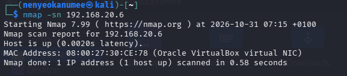

*Figure 3.1: Host discovery, 192.168.20.6 is up*

### 3.2 Open ports and services

The command nmap -sV -O 192.168.20.6 identified several open services on the target, including FTP, SSH, Telnet, SMTP, and RPCBind. Operating system detection also identified the host as running a Linux 2.6.X kernel. The scan additionally returned the target's MAC address. The results are presented in Figure 3.2.

The command nmap -p- 192.168.20.6 scanned all 65,535 TCP ports on the target host. The results identified additional open services, including VNC, NFS, and IRC. The complete scan output is provided in the attached Nmap Scan Result.

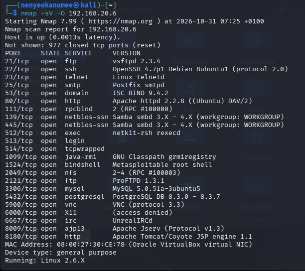

*Figure 3.2: Open ports, service versions, and OS detection*

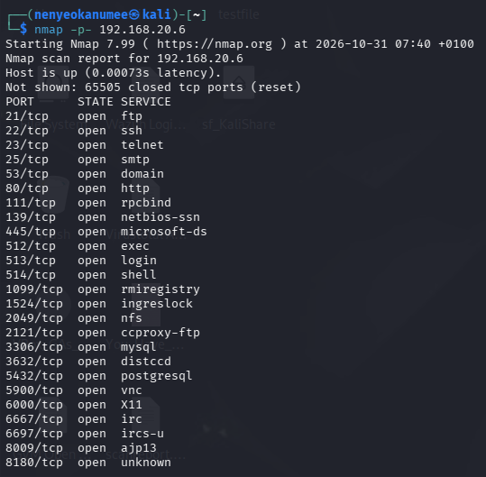

*Figure 3.3: Full 65,535 TCP port scan (first 25 of 30 open ports shown). The complete Nmap scan result is attached to this project.*

| Port | Service | Version | Why it Matters |
| --- | --- | --- | --- |
| 21 | ftp | vsftpd 2.3.4 | Version with a known backdoor (VUL-007). Anonymous FTP login is allowed. |
| 22 | SSH | OpenSSH 4.7p1 Debian 8ubuntu1 (protocol 2.0) | An SSH service is running, but no SSH authentication results were recorded in the Greenbone report (see 2.3 and 2.4). |
| 23 | telnet | Linux telnetd | sends credentials in clear text |
| 80 | http | Apache httpd 2.2.8 ((Ubuntu) DAV/2) | Web server hosting TWiki, which is outdated (VUL-005). |
| 139/445 | netbios-ssn / microsoft-ds | 139: Samba smbd 3.X – 4.X. 445: Samba smbd 3.0.20-Debian (-sC -sV run) | SMB file-sharing services. Greenbone’s SMB login on port 445 succeeded (Appendix A). Not among the Critical findings. |
| 512 | exec | netkit-rsh rexecd | Exposed, credentials unencrypted. |
| 513 | rlogin | OpenBSD or Solaris rlogind | Legacy remote-access services; rlogin allowed root without a password (VUL-001). |
| 514 | Shell | tcpwrapped | Remote shell (rsh) service, in the same legacy family as rexec and rlogin (VUL-001). Nmap reports it as tcpwrapped, so no version was identified. Not among the Critical findings. |
| 1524 | Ingreslock | Metasploitable root shell | Nmap labels it a root shell (VUL-003). |
| 2049 | NFS | 2-4 (RPC #100003) | File-sharing service exposed to the network. Whether its exports are restricted was not tested. Not among the Critical findings. |
| 3306 | mysql | MySQL 5.0.51a-3ubuntu5 | Greenbone logged in as root with an empty password (VUL-006). |
| 3632 | distccd | Not identified by Nmap | DistCC; Greenbone ran a command as daemon (VUL-009) |
| 5432 | postgresql | PostgreSQL DB 8.3.0 - 8.3.7 | Greenbone logged in with default credentials (VUL-010). |
| 5900 | vnc | VNC (protocol 3.3) | Password-only VNC; Greenbone connected with a default password (VUL-011). |
| 6667 | IRC | UnrealIRCd | Nmap’s vulnerability script flagged it as trojaned (Figure 3.5) |
| 8009 | ajp13 | Apache Jserv (Protocol v1.3) | AJP connector exposed (VUL-008). |
| 8787 | msgsrvr (dRuby/DRb per Greenbone) | Not identified by Nmap | dRuby exposed (VUL-002). |

**Table 3.1: Summary of Selected Open Ports and Services.** The table presents selected open ports, their associated services, and detected versions, based on the Nmap results shown in Figures 3.2 and 3.4. The full list of 30 open ports is in the attached Nmap scan result.

### 3.3 Script scan highlights

The command nmap -sC -sV 192.168.20.6 was used to gather additional information about the services identified during the initial scan. The results confirmed that vsftpd 2.3.4 was running on port 21 and OpenSSH 4.7p1 was running on port 22. Additional service information is presented in Figure 3.4.

The command nmap --script vuln 192.168.20.6 was executed to check the target for known vulnerability indicators. The results identified the vsftpd 2.3.4 backdoor vulnerability (CVE-2011-2523), as shown in Figure 3.5. The vsftpd backdoor was also identified during the subsequent Greenbone vulnerability assessment.

The script also flagged other indicators, including an UnrealIRCd service on port 6667 and the Java RMI registry on port 1099. These are not among the 11 findings because this report covers only the Critical results in the Greenbone report, which rates the Java RMI result (1099/tcp) High (7.5) and its UnrealIRCd result (6697/tcp) High (8.1).

The full Nmap scan report is attached to this project.

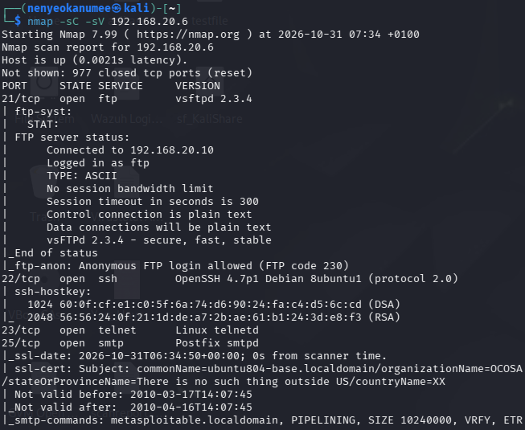

*Figure 3.4: Default script scan results*

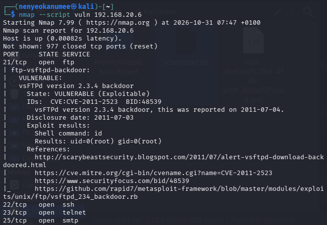

*Figure 3.5: Vulnerability script detections*

## 4. Vulnerability Scan Results (Greenbone)

### 4.1 Severity summary

The scan returned 634 results, but with a minimum QoD of 70% applied, it returned 160 results: 70 results (13 Critical, 11 High, 40 Medium, and 6 Low) and 90 log-level results.

Results breakdown:

- Number of Critical results: 13

- Number of High results: 11

- Number of Medium results: 40

- Number of Low results: 6

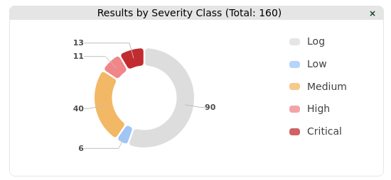

*Figure 4.1: Greenbone severity summary for scan of 192.168.20.6 (Metasploitable 2), run on 31st October 2026*

The 13 Critical results affected a total of 12 ports plus one host-wide result. The 12 ports are 21, 80, 512, 513, 1524, 3306, 3632, 5432, 5900, 6200, 8009, 8787.

rexec and rlogin are grouped into one finding, while ports 21 and 6200 are grouped into one finding, making it a total of 11 findings.

The complete export (all four severity levels) is attached to this project.

### 4.2 Notes on the scan

- rlogin and rexec share a root cause and a fix, so they are grouped into one finding.

- MySQL and VNC CVEs are rejected because Greenbone lists CVEs that describe other products using weak credentials, so they weren’t applied.

- Appendix A details the authentication analysis.

## 5. Technical Findings

### 5.1 Vulnerability Findings Summary Table

| ID | Vulnerability | Severity | Port/Service | CVE | CVSS (state version) | Evidence |
| --- | --- | --- | --- | --- | --- | --- |
| VUL-001 | Legacy r-services exposed | Critical | 512/tcp rexec, 513/tcp rlogin | CVE-1999-0618 (rexec); none for rlogin | 10.0 (Critical, Greenbone) for both rlogin and rexec. 10.0 (v2.0 High, NVD) for rexec | Figure 5.1a, Figure 5.1b |
| VUL-002 | Distributed Ruby (dRuby/DRb) service exposed | Critical | 8787/tcp | None (misconfiguration) | 10.0 (Critical, Greenbone). | Figure 5.2 |
| VUL-003 | Backdoor service on Ingreslock port | Critical | 1524/tcp | None (no CVE assigned) | 10.0 (Critical, Greenbone). | Figure 5.3 |
| VUL-004 | Operating System (OS) reached its End of Life (EOL) | Critical | Host-wide (no port) | None (no CVE assigned) | 10.0 (Critical, Greenbone). | Figure 5.4 |
| VUL-005 | Outdated TWiki with cross-site scripting and command execution flaws | Critical | 80/tcp | CVE-2008-5304, CVE-2008-5305 | CVE-2008-5304: 4.3 (v2.0 Medium, NVD). CVE-2008-5305: 10.0 (v2.0 High, NVD). | Figure 5.5 |
| VUL-006 | MySQL / MariaDB accepted default credentials | Critical | 3306/tcp | None applicable (default credentials) | 9.8 (Critical, Greenbone) | Figure 5.6 |
| VUL-007 | vsftpd 2.3.4 backdoor | Critical | 21/tcp, 6200/tcp (shell opened by the trigger). | CVE-2011-2523 | 9.8 (v3.1 Critical, NVD) | Figure 5.7a, Figure 5.7b, Figure 5.7c |
| VUL-008 | Apache Tomcat Vulnerable to AJP Requests | Critical | 8009/tcp | CVE-2020-1938 | 9.8 (v3.1 Critical, NVD) | Figure 5.8 |
| VUL-009 | DistCC is prone to a remote code execution | Critical | 3632/tcp | CVE-2004-2687 | 9.3 (v2.0 High, NVD) | Figure 5.9 |
| VUL-010 | PostgreSQL server accepts default credentials | Critical | 5432/tcp | None (misconfiguration) | 9.0 (Critical, Greenbone) | Figure 5.10 |
| VUL-011 | VNC server accepts a default password | Critical | 5900/tcp | None applicable (default credentials) | 9.0 (Critical, Greenbone) | Figure 5.11 |

### 5.2 Detailed findings

#### VUL-001: Legacy r-services exposed (Greenbone NVTs: The rexec service is running; rlogin Passwordless Login)

- **Affected:** rexec on 512/tcp and rlogin on 513/tcp.
- **CVE:** CVE-1999-0618 (rexec); None (misconfiguration) (rlogin).
- **CVSS:** CVSS v2.0 base score 10.0 (High), source: NVD, for rexec. Greenbone rates both services Critical (10.0).
- **Description:** Both services allow remote command access. Rexec authenticates without encryption. Greenbone detected that rexec is running and showed that rlogin permits root login without a password.
- **Impact:** The rexec service transmits credentials without encryption, making them susceptible to interception by an attacker with access to the network traffic. The rlogin finding presents a more severe risk because Greenbone confirmed that root access was possible without a password, potentially allowing complete control of the host.
- **Fix:** Disable both, use SSH, and block the ports at the firewall.
- **Evidence:**

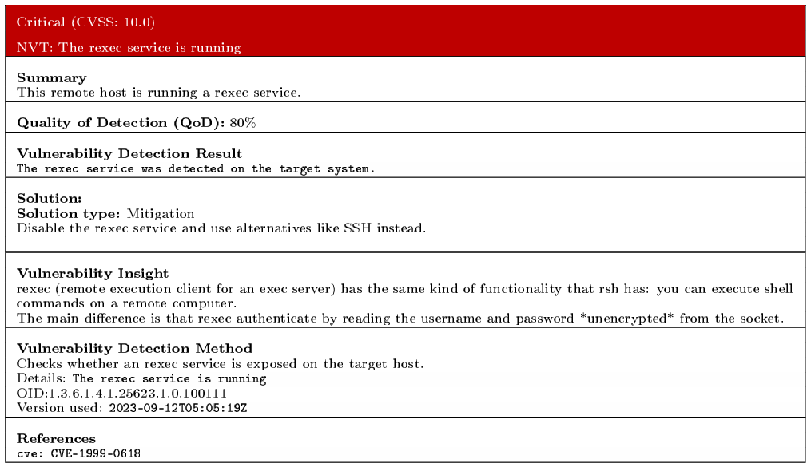

*Figure 5.1a: Greenbone result showing the rexec service exposed on 192.168.20.6:512/tcp (CVE-1999-0618 listed as reference)*

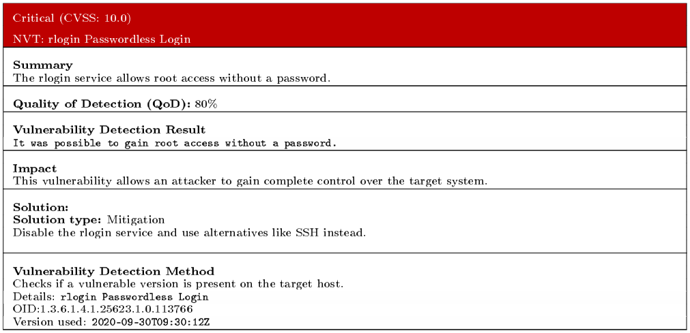

*Figure 5.1b: Greenbone result showing rlogin permits passwordless root login on 192.168.20.6:513/tcp*

#### VUL-002: Distributed Ruby (dRuby/DRb) service exposed (Greenbone NVT: Multiple Remote Code Execution Vulnerabilities).

- **Affected:** 8787/tcp
- **CVE:** None (misconfiguration).
- **CVSS:** 10.0 (Critical), Greenbone-assigned, QoD 99%.
- **Description:** Permits unauthorised remote method invocation (RMI) without authentication across a network. Greenbone sent a crafted syscall request to the service and received a response, showing that remote syscalls are executed even though the service runs in \$SAFE \>= 1 mode.
- **Impact:** Remote code execution on the host system with the privileges of the account running the service. If that account is root, an attacker could obtain root privileges.
- **Fix:** Configure ACLs to permit trusted IP addresses or networks. Permit only trusted hosts; deny everything else. Block 8787/tcp at the firewall, and bind the service to localhost if it doesn’t need remote access. Greenbone’s solution also lists setting \$SAFE levels appropriately (at least 2 where untrusted hosts can submit commands) and using taint on untrusted input.
- **Evidence:**

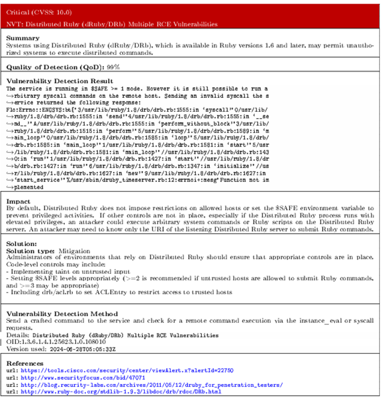

*Figure 5.2: Greenbone result showing Distributed Ruby (dRuby/DRb) Multiple RCE Vulnerability on 192.168.20.6:8787/tcp.*

#### VUL-003: Backdoor service on Ingreslock port (Greenbone NVT: Possible Backdoor: Ingreslock)

- **Affected:** 1524/tcp.
- **CVE:** None (no CVE assigned).
- **CVSS:** 10.0 (Critical), Greenbone-assigned, QoD 99%.
- **Description:** Port 1524 is open, and Greenbone detected a backdoor service listening on it. The backdoor is bound to a root shell and responds to commands.
- **Impact:** Greenbone sent the id command to port 1524, and the service responded as uid=0(root), so an attacker can run commands as root without credentials.
- **Fix:** Identify the listening process, find out how it got there, and rotate credentials. Re-provision the compromised host and block inbound traffic on port 1524.
- **Evidence:**

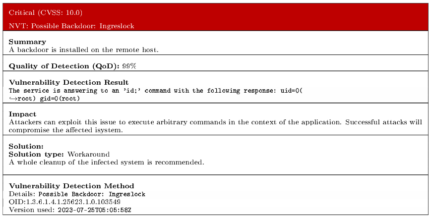

*Figure 5.3: Greenbone result showing a root shell responding to the id command on 192.168.20.6:1524/tcp (NVT: Possible Backdoor: Ingreslock)*

#### VUL-004: Operating System (OS) reached its End of Life (EOL).

- **Affected:** Host-wide (operating system), no port.
- **CVE:** None (no CVE assigned).
- **CVSS:** 10.0 (Critical), Greenbone-assigned, QoD 80%.
- **Description:** The host runs Ubuntu Linux 8.04, which reached end of life on 9 May 2013 and no longer receives security updates (Figure 5.4 below).
- **Impact:** The absence of vendor security updates increases the likelihood that known and newly discovered vulnerabilities will remain unpatched. This also increases the overall risk associated with the other vulnerable services and software identified on the host.
- **Fix:** Migrate the services to a currently supported LTS release on a newly built host and decommission this one. Until then, restrict network access to the host.
- **Evidence:**

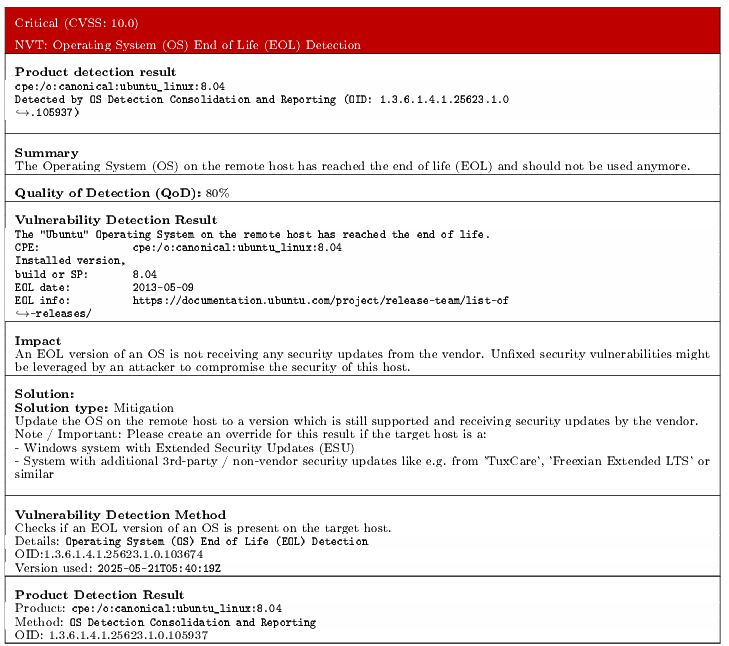

*Figure 5.4: Greenbone result showing Ubuntu Linux 8.04, which reached end of life on 9 May 2013 detected on 192.168.20.6 (NVT: Operating System (OS) End of Life (EOL) Detection).*

#### VUL-005: Outdated TWiki with cross-site scripting and command execution flaws (Greenbone NVT: TWiki \< 4.2.4 Multiple XSS / Command Execution Vulnerabilities)

- **Affected:** 80/tcp, TWiki (detected version string 01.Feb.2003; fixed version: 4.2.4).
- **CVE:** CVE-2008-5304 and CVE-2008-5305
- **CVSS:** CVE-2008-5304: 4.3 (v2.0 Medium, NVD). CVE-2008-5305: 10.0 (v2.0 High, NVD), Greenbone detection QoD 80%.
- **Description:** Greenbone identified a TWiki version earlier than the fixed version 4.2.4. The %URLPARAM{} variable is insufficiently sanitised, creating a potential cross-site scripting (XSS) vulnerability. The %SEARCH{} variable is also insufficiently sanitised before being passed to an eval() call, potentially allowing remote attackers to execute Perl code.
- **Impact:** The %SEARCH{}% flaw lets an unauthenticated remote attacker run Perl code on the web server, which can compromise the application and potentially the host. The XSS flaw can be used against site users, and Greenbone notes it could allow theft of cookie-based credentials.
- **Fix:** Update TWiki to a currently supported release. Restrict access with a firewall or reverse proxy until then. Remove it if it is not needed.
- **Evidence:**

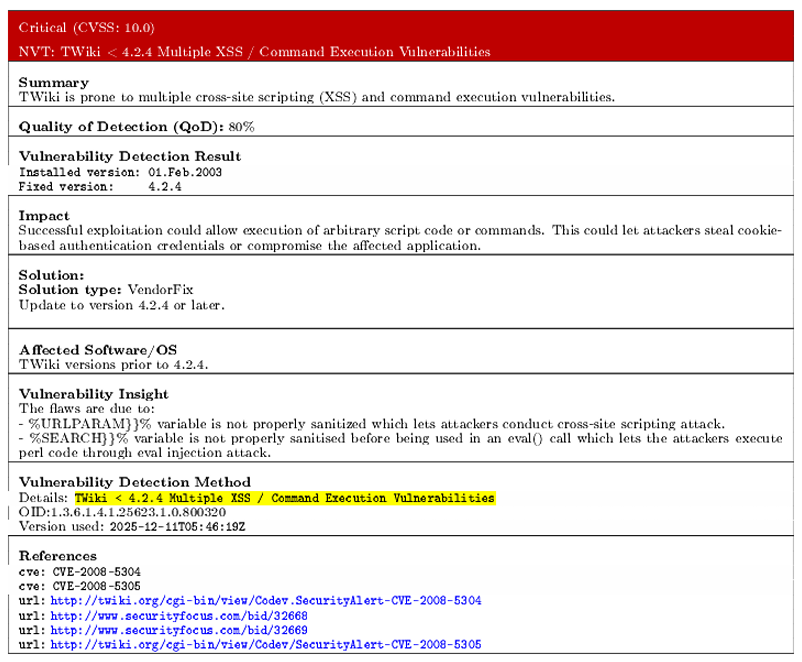

*Figure 5.5: Greenbone result showing Outdated TWiki with cross-site scripting and command execution flaws on 192.168.20.6:80/tcp.*

#### VUL-006: MySQL / MariaDB accepted default credentials (Greenbone NVT: MySQL / MariaDB Default Credentials (MySQL Protocol))

- **Affected:** 3306/tcp
- **CVE:** None applicable (default credentials)
- **CVSS:** 9.8 (Critical), Greenbone assigned. QoD 95%
- **Description:** Permits login to MySQL as user “root” with an empty password on port 3306/tcp.
- **Impact:** Successful authentication using the MySQL root account could provide administrative control over the MySQL instance and its data. The finding does not, by itself, establish operating-system root access.
- **Fix:** Set a strong password for login or delete the account. Restrict 3306/tcp to only application servers that require it.
- **Evidence:**

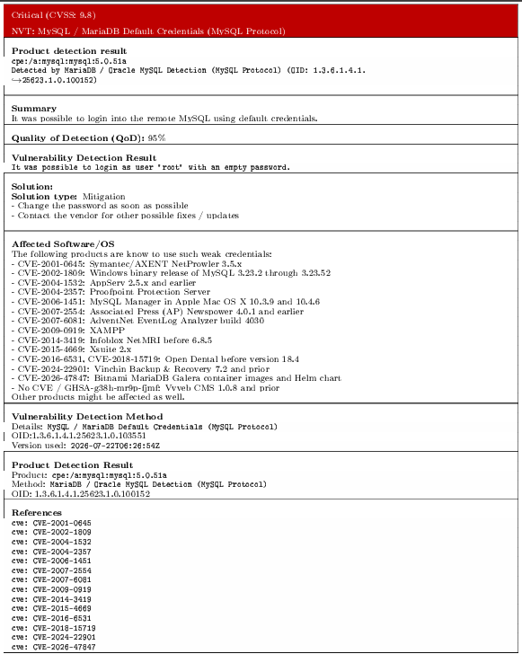

*Figure 5.6: Greenbone result showing MySQL / MariaDB accepts default credentials on 192.168.20.6:3306/tcp*

#### VUL-007: vsftpd 2.3.4 backdoor.

- **Affected:** port 21/tcp, port 6200/tcp (shell opened by a trigger), vsftpd 2.3.4.
- **CVE:** CVE-2011-2523.
- **CVSS:** 9.8 (Critical), CVSS v3.1, NVD. Greenbone detection QoD 99%.
- **Description:** A login attempt with a username ending in :) opens a command shell on port 6200/tcp. Nmap ran id through the backdoor and got uid=0(root), and Greenbone also detected it.
- **Impact:** Remotely exploitable without authentication, giving a root command shell and full control of the host.
- **Fix:** Restrict access to port 21 using firewall rules. Remove the vulnerable vsftpd 2.3.4 installation and replace it with a supported FTP server version. If secure file transfer is required, consider using SFTP. Investigate for a listener on port 6200/tcp, and review the relevant FTP logs.
- **Evidence:**

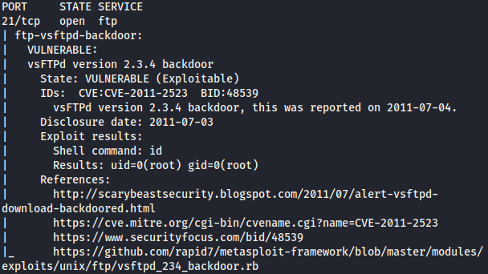

*Figure 5.7a: Nmap ftp-vsftpd-backdoor script confirming CVE-2011-2523 on 192.168.20.6:21*

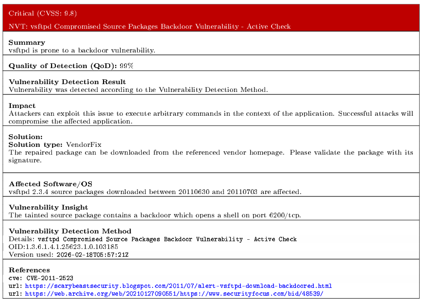

*Figure 5.7b: Greenbone result showing vsftpd Compromised Source Packages Backdoor Vulnerability - Active Check on 192.168.20.6:21/tcp (CVE-2011-2523 listed as reference)*

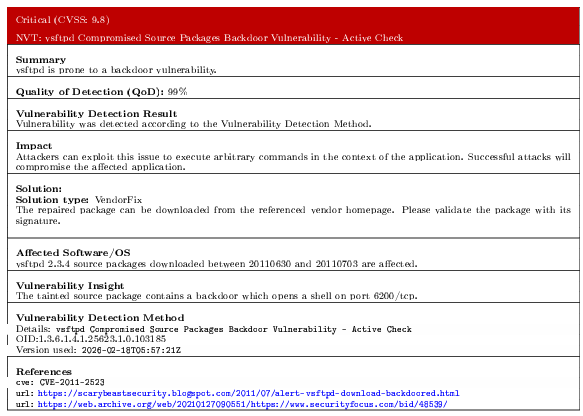

*Figure 5.7c: Greenbone result showing vsftpd Compromised Source Packages Backdoor Vulnerability - Active Check on 192.168.20.6:6200/tcp (CVE-2011-2523 listed as reference)*

#### VUL-008: Apache Tomcat Vulnerable to AJP Requests (Apache Tomcat AJP RCE Vulnerability (Ghostcat) - Active Check)

- **Affected:** 8009/tcp
- **CVE:** CVE-2020-1938
- **CVSS:** 9.8 (Critical), CVSS v3.1, NVD. Greenbone detection QoD 99%.
- **Description:** An AJP flaw lets an attacker read files from the web application, and it leads to code execution only if the app lets them upload files. Greenbone read /WEB-INF/web.xml through the AJP connector.
- **Impact:** An attacker can read files from the Tomcat web application through the AJP connector and can achieve code execution if the application lets users upload files.
- **Fix:** Migrate Apache Tomcat to a currently supported release, block AJP requests on the firewall, and allow only trusted hosts.
- **Evidence:**

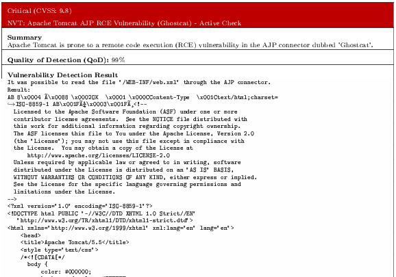

*Figure 5.8: Greenbone detects Apache Tomcat AJP RCE Vulnerability (Ghostcat) - Active Check on 192.168.20.6:8009/tcp*

#### VUL-009: DistCC is prone to a remote code execution (DistCC RCE Vulnerability)

- **Affected:** 3632/tcp
- **CVE:** CVE-2004-2687
- **CVSS:** 9.3 (High), CVSS v2.0, NVD. Greenbone detection QoD 99%.
- **Description:** The exposed DistCC service may permit remote command execution through compilation jobs submitted without adequate authorisation checks. Greenbone's active check demonstrated command execution on the target host. The specific installed DistCC version was not established by the Nmap results.
- **Impact:** Greenbone sent an id command to port 3632/tcp, and it responded to the id command as uid=1(daemon), a background system service. A malicious client can execute commands on the server without authentication. That is remote code execution, and the lower privilege level reduces the damage.
- **Fix:** Update DistCC to a currently supported release. Configure DistCC to restrict access to the server port.
- **Evidence:**

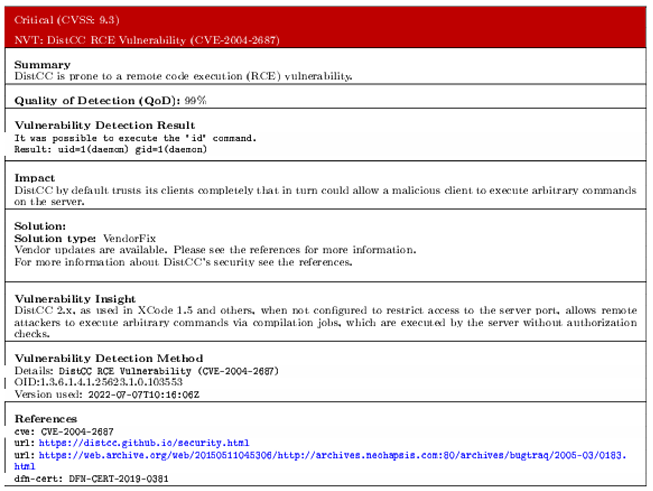

*Figure 5.9: Greenbone result showing that DistCC is prone to remote code execution on 192.168.20.6:3632/tcp*

#### VUL-010: PostgreSQL server accepts default credentials (Greenbone NVT: PostgreSQL Default Credentials (PostgreSQL Protocol))

- **Affected:** 5432/tcp
- **CVE:** None (misconfiguration)
- **CVSS:** 9.0 (Critical), Greenbone-assigned; QoD 99%
- **Description:** Greenbone logged in to the PostgreSQL service on 5432/tcp with the username postgres and the password postgres.
- **Impact:** An attacker can log in using postgres as the username and password. However, Greenbone can't confirm the privileges on the account, so the extent of the access is unconfirmed.
- **Fix:** Change the password to a much stronger password or remove the account. Restrict 5432/tcp to the application servers that need it.
- **Evidence:**

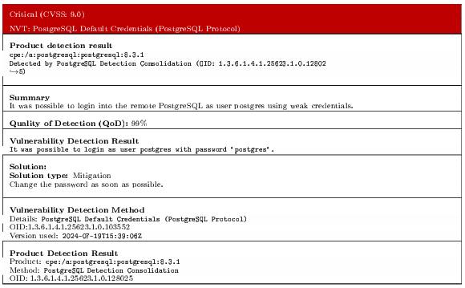

*Figure 5.10: Greenbone result showing PostgreSQL accepting the default credentials postgres/postgres on 192.168.20.6:5432/tcp.*

#### VUL-011: VNC server accepts a default password (Greenbone NVT: VNC Brute Force Login)

- **Affected:** 5900/tcp
- **CVE:** None applicable (default credentials). Greenbone lists CVE-2026-65313 as a reference, but NVD describes it as a HIPASE-250 workstation provisioning flaw, so it was not used.
- **CVSS:** 9.0; Greenbone assigned, QoD 70%
- **Description:** Greenbone connected to the VNC service using the password “password”, so the server accepts a default password.
- **Impact:** An attacker who can reach 5900/tcp can authenticate with the password “password” and gain remote graphical control of the host, with the privileges of the account running the VNC server.
- **Fix:** Change the password to a much stronger password, restrict 5900/tcp at the firewall, and require access through an SSH tunnel or VPN.
- **Evidence:**
  
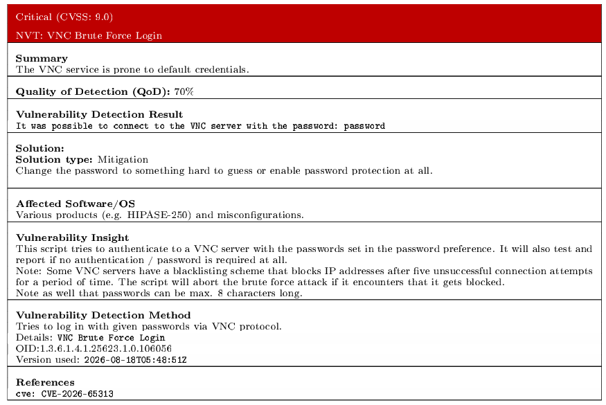

*Figure 5.11: Greenbone result showing VNC accepted the password “password” on 192.168.20.6:5900/tcp*

## 6. Risk Rating and Prioritisation

### 6.1 Rating method

Findings are rated Low, Medium, High, or Critical. The following rules apply:

1.  The Severity column is Greenbone’s class, and the NVD score is shown beside it for reference.

2.  Findings with no CVEs use Greenbone’s score.

3.  Findings were not rescored.

4.  Only Greenbone’s Critical results are included in this report. High, Medium, and Low are intentionally excluded.

In a production environment, the ranking will also weigh asset criticality, data sensitivity, and exposure to the internet, which a lab target doesn’t have.

### 6.2 Prioritisation Criteria

The findings were prioritised using the following criteria:

1.  **Evidence of Exploitation**: Whether the assessment confirmed command execution, successful authentication, or only detected an exposed service.

2.  **Authentication Required**: Whether access was obtained without authentication or through the use of default credentials.

3.  **Privilege gained**: Whether the demonstrated access was at root level, a lower operating-system privilege level, or a database account.

4.  **Network Exposure**: Whether the service was accessible over the assessment network.

All findings are network-exposed, so the network exposure criterion doesn’t separate them.

### 6.3 Priority Table

| Rank | Priority | ID | Finding | Evidence Level | Privilege | Why this Rank |
| --- | --- | --- | --- | --- | --- | --- |
| 1 | Immediate | VUL-001 | Legacy r-services exposed | rlogin was confirmed But rexec was detected. | rlogin: Unauthenticated root-level access was confirmed. rexec: Service exposure was detected, but successful command execution was not established. | Ranks first, tied with VUL-003 and VUL-007 because root access is granted without a password on rlogin. While the rexec vulnerability was only detected, rexec alone would rank lower. |
| 2 | Immediate | VUL-003 | Backdoor service on Ingreslock port | Confirmed | Confirmed root-level command execution through the backdoor service without authentication. | Ranked second because root access is granted without authentication |
| 3 | Immediate | VUL-007 | vsftpd 2.3.4 backdoor | Confirmed | Confirmed root-level command execution through the vsftpd backdoor without authentication. | As important as the first two, since root access without authentication is granted |
| 4 | Urgent | VUL-009 | DistCC is prone to remote code execution | Confirmed | Command execution as daemon | Ranked below the root findings because the command ran as the low-privileged daemon account, and above the credential findings because command execution was demonstrated without any credentials. |
| 5 | Urgent | VUL-002 | Distributed Ruby (dRuby/DRb) service exposed | Confirmed | Remote syscall execution without password demonstrated; privilege level not shown. | Ranked 5th because DistCC returned an identity (daemon) while dRuby’s check only indicated remote syscall execution, and the privilege level was not established. |
| 6 | Urgent | VUL-006 | MySQL / MariaDB accepted default credentials | Confirmed | Successful root login to MySQL database and complete control of the database | Ranked below VUL-002 because the dRuby finding demonstrated remote syscall execution, while the MySQL finding confirmed administrative access to the database instance. It was ranked above VUL-010 because the MySQL root account accepted an empty password. |
| 7 | Urgent | VUL-010 | PostgreSQL server accepts default credentials | Confirmed | Logged in to the database as the postgres account. | VUL-010 ranks above VUL-011 because a database login exposes data directly, while VNC gives an interactive desktop session |
| 8 | Urgent | VUL-011 | VNC server accepts a default password | Confirmed | Remote graphical session login with default credentials as whatever account runs VNC. | Ranked above VUL-008 because a file read gives information, not control. |
| 9 | Urgent | VUL-008 | Apache Tomcat Vulnerable to AJP Requests | Confirmed | Attacker can read files. | Ranks above VUL-005 because ability to read files ranks higher than version check. |
| 10 | Urgent | VUL-005 | Outdated TWiki with cross-site scripting and command execution flaws | Detected | No access was demonstrated | Ranked last of the Urgent findings because it is a version check, so nothing was demonstrated. |
| 11 | Planned | VUL-004 | Operating System (OS) reached its End of Life (EOL) | Detected | No access is gained directly | This is a host-wide lifecycle and patch-management exposure. Its lower remediation priority is justified by the absence of demonstrated direct access. It raises the risk of every other finding. |

Immediate findings gave root access without authentication or a password; none of the Urgent findings gave confirmed operating-system root access. Ranks 1 to 3 are tied; each gave confirmed root access without authentication.

### 6.4 The three to fix first

| Rank | Findings                                    | Reasoning                                                                           |
|------|---------------------------------------------|-------------------------------------------------------------------------------------|
| 1    | VUL-001 Legacy r-services exposed           | rlogin gave root access without a password, confirmed by a command or login result. |
| 2    | VUL-003 Backdoor service on Ingreslock port | Root access without authentication.                                                 |
| 3    | VUL-007 vsftpd 2.3.4 backdoor               | vsftpd 2.3.4 gave backdoor root access without authentication                       |

VUL-001, VUL-003, and VUL-007 are ranked immediate and should be addressed first because root access is confirmed for all three findings without authentication: rlogin, ingreslock, and vsftpd.

## 7. Remediation Recommendations

The recommended fix for each finding is given under “Fix” in the detailed findings (section 5.2). The order in which the findings should be addressed is set by the priority table (section 6.3), and the three most urgent findings are explained in section 6.4. Once the fixes are applied, the same Greenbone scan should be re-run to confirm that the findings no longer appear.

## 8. Conclusion

In this lab, 192.168.20.6 (Metasploitable 2, a deliberately vulnerable lab target) hosted on VirtualBox in NAT Network 192.168.20.0/24 was tested using Nmap for reconnaissance and Greenbone for vulnerability scanning on 31 October 2026. Greenbone ran from 07:04 to 08:04 UTC. The scan returned 13 Critical results, grouped into 11 findings.

VUL-001, VUL-003, and VUL-007 are the highest-priority findings because the assessment confirmed unauthorised root-level access through rlogin, the Ingreslock backdoor, and the vsftpd backdoor. The assessment focused on Critical results, and no SSH authentication results were recorded; therefore, local security checks on the Linux host were not confirmed. The recommended remediation actions should be implemented, followed by a repeat scan to verify that the identified vulnerabilities have been addressed. Refer to the detailed remediation recommendations in Section 7.

## 9. Appendix

### Appendix A: Scan Authentication Verification Table

| ID | Finding | Line Used | Group |
| --- | --- | --- | --- |
| VUL-001 | Legacy r-services exposed | rlogin: It was possible to gain root access without a password. rexec: Checks whether an rexec service is exposed on the target host. | Network-reachable (both) |
| VUL-002 | Distributed Ruby (dRuby/DRb) service exposed | Send a crafted command to the service and check for remote command execution via the instance_eval or syscall requests. | Network-reachable |
| VUL-003 | Backdoor service on Ingreslock port | The service is answering to an ’id;’ command with the following response: uid=0(root) gid=0(root) | Network-reachable |
| VUL-004 | Operating System (OS) reached its End of Life (EOL) | Checks if an EOL version of an OS is present on the target host. | Derived from OS detection; sources not stated |
| VUL-005 | Outdated TWiki with cross-site scripting and command execution flaws | Installed version: 01.Feb.2003 Fixed version: 4.2.4 | Version check |
| VUL-006 | MySQL / MariaDB accepted default credentials | It was possible to log in as user "root" with an empty password. | Network-reachable |
| VUL-007 | vsftpd 2.3.4 backdoor | The tainted source package contains a backdoor which opens a shell on port 6200/tcp. | Network-reachable |
| VUL-008 | Apache Tomcat Vulnerable to AJP Requests | Sends a crafted AJP request and checks the response. | Network-reachable |
| VUL-009 | DistCC is prone to remote code execution | It was possible to execute the "id" command. Result: uid=1(daemon) gid=1(daemon) | Network-reachable |
| VUL-010 | PostgreSQL server accepts default credentials | It was possible to log in to the remote PostgreSQL as user postgres using weak credentials. | Network-reachable |
| VUL-011 | VNC server accepts a default password | Tries to log in with given passwords via VNC protocol. | Network-reachable |
