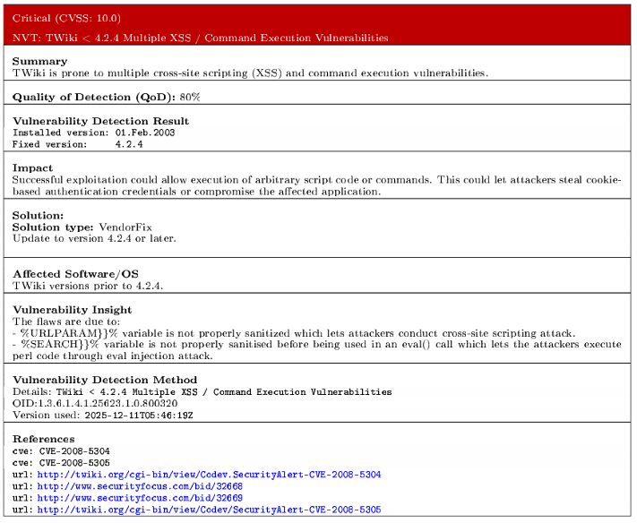
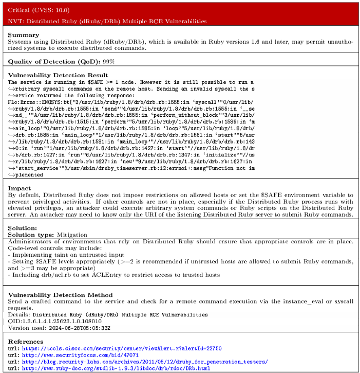
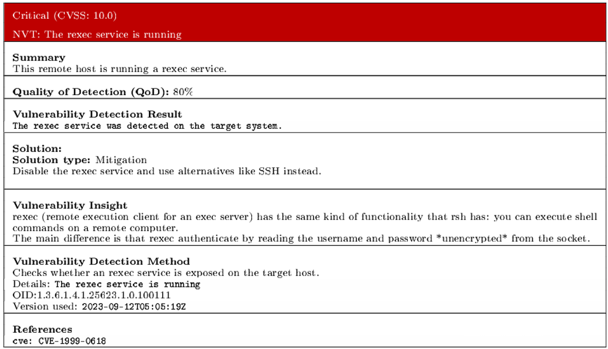
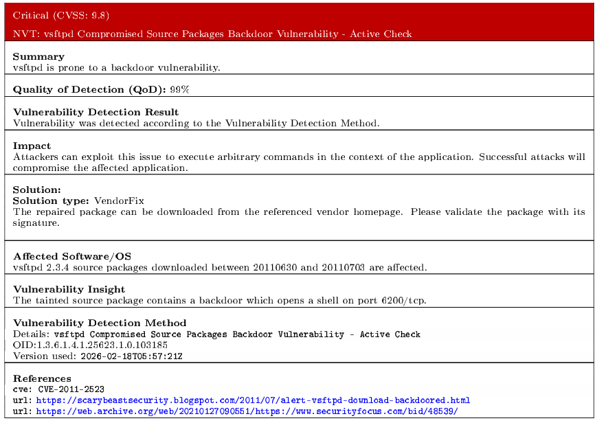
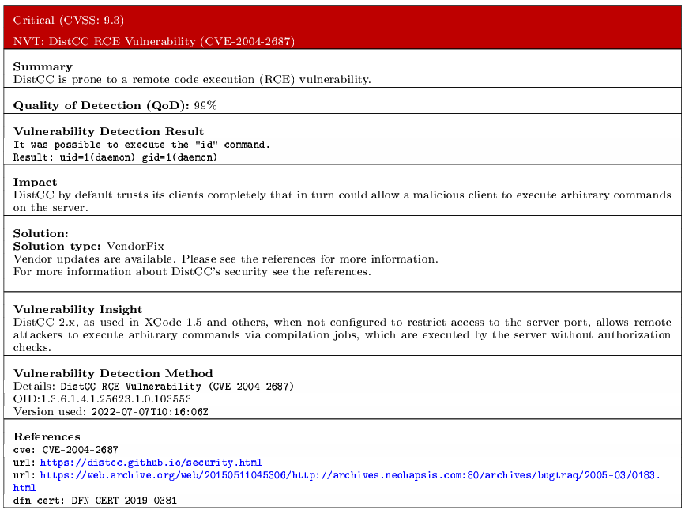

# From Vulnerability to Compliance: Securing Legacy and Cloud Systems at HanTech

**HanTech Security Assessment Report** | Cybersecurity Capstone Project, TS Academy | Group 88

Prepared for HanTech management.

## Group members

| # | Group members |
|---|---|
| 1 | Chukwunenye Okanumee (Team Lead) |
| 2 | Oluwakayode Adebesin |
| 3 | Oyekoya Olusegun Olamide |
| 4 | Tobiloba Abiodun |
| 5 | Adewumi Oluwamayowa Moses |
| 6 | Precious Aniefuna |
| 7 | Ayotunde Akingbola Enoch |

## Executive Summary

### Key Findings

We reviewed a vulnerability scan of one HanTech system and selected five Critical weaknesses from the scan report. All five are rated Critical, the highest level. Each one could let an attacker take control of the system, run commands without permission, or access sensitive information. Two stem from outdated or tampered software, and three from services left open to the network without enough protection. Left unfixed, they could lead to unauthorised access, data breaches, service disruption, regulatory problems, and damage to HanTech’s reputation.

### Highest-risk vulnerabilities

On the assessed host, contain the backdoor (VUL-004) and unauthorised remote-execution (VUL-001, VUL-002 and VUL-005) paths. Prioritise permanent remediation according to confirmed exploitability, reachable attack paths, service privileges, asset criticality, and business dependencies. Disable rexec (VUL-003) promptly because it exposes credentials in cleartext. The scan identifies exposure on the assessed host; it does not establish whether any data has been stolen.

### Recommended controls

We recommend replacing the unprotected remote-login service with an encrypted one, removing the tampered file-transfer software, and checking whether the server has already been accessed. HanTech should also update or replace the outdated applications, limit access to these services, disable anything it does not need, and monitor sign-in records for suspicious activity. In the cloud, every account should use multi-factor sign-in, people should receive only the access their role needs, data should be encrypted, and settings should be reviewed regularly.

### Recommended policies

We recommend nine policies. Five matter most: patch management (updates installed on time), configuration management (secure settings, unneeded services switched off), vulnerability management (regular scans and fixes in order of severity), access control, and password and authentication. Information security, secure development, disaster recovery, and business continuity policies support them. HanTech should also confirm which data protection laws apply to the data it handles, mainly the Nigeria Data Protection Act 2023, and GDPR, PCI DSS, or HIPAA where relevant.

### Overall security posture

Based on this evidence, the assessed system’s exposure is high: all five findings are Critical and point to gaps in basic practices such as timely updates, secure settings, and controlled access. The scan covered one system and no cloud accounts, so it cannot show how widespread these gaps are across HanTech. We recommend validating whether similar conditions exist elsewhere. With the actions above, the most serious exposure can be reduced quickly.

### Limitation

This capstone uses the supplied scan of a HanTech host, 192.168.20.6. Findings apply directly to the assessed host. Recommendations for HanTech’s production and cloud environments are scenario-based and require validation through separate assessments. No cloud account was directly assessed.

## Vulnerability Findings

This assessment uses the supplied “Metasploitable 2 - TSA Capstone Project Vulnerability Scan (Group 88),” dated 1 November 2026, as the technical evidence for the HanTech capstone scenario. The assessed host, 192.168.20.6, is a HanTech legacy system for this project.

The five selected findings describe weaknesses identified on that assessed host. They do not independently establish that the same weaknesses exist in HanTech’s production systems or cloud accounts. References to HanTech’s services, business impacts, and security requirements reflect the project scenario and are used to develop recommendations.

No direct assessment of HanTech’s cloud accounts is included in the evidence presented. Cloud controls and compliance considerations are therefore recommendations for the scenario, not confirmed findings about a cloud deployment. The scan evidence also does not establish that an external attacker accessed the host or that business or personal data was stolen.

### Summary of findings

| #  | **Vulnerability**                                                                | **Affected service**              | **Port** | **CVE (or none)**               | **Report page** |
|---------|----------------------------------------------------------------------------------|-----------------------------------|----------|---------------------------------|-----------------|
| VUL-001 | TWiki \< 4.2.4 multiple XSS / command execution vulnerabilities.                 | TWiki (web application over HTTP) | 80/tcp   | CVE-2008-5304 and CVE-2008-5305 | pp. 10–11       |
| VUL-002 | Distributed Ruby (dRuby/DRb) has multiple remote code execution vulnerabilities. | Distributed Ruby (dRuby/DRb)      | 8787/tcp | None listed                     | pp. 12–13       |
| VUL-003 | rexec service running (unencrypted remote execution).                            | rexec (remote execution)          | 512/tcp  | CVE-1999-0618                   | pp. 3–4         |
| VUL-004 | vsftpd compromised source package backdoor.                                      | vsftpd                            | 6200/tcp | CVE-2011-2523                   | p. 4           |
| VUL-005 | DistCC remote code execution vulnerability                                       | DistCC                            | 3632/tcp | CVE-2004-2687                   | p. 3           |

### VUL-001: TWiki \< 4.2.4 Multiple XSS / Command Execution Vulnerabilities

|                               |                                                                                                                                                                                                                                              |
|-------------------------------|----------------------------------------------------------------------------------------------------------------------------------------------------------------------------------------------------------------------------------------------|
| **Affected service and port** | TWiki (Web Application over HTTP) - 80/tcp                                                                                                                                                                                                   |
| **Brief description**         | The TWiki web application is running a version older than 4.2.4. Multiple vulnerabilities, including Cross-Site Scripting (XSS) and command execution, could allow an attacker to execute unauthorised commands or inject malicious scripts. |
| **Potential attacker goal**   | To execute unauthorised commands on the server, compromise the web application, or gain access to sensitive information.                                                                                                                     |
| **Evidence**                  | Refer to Appendix A Figure 5.1: OpenVAS scan evidence, pages 10–11.                                                                                                                                                                          |

### VUL-002: Distributed Ruby (dRuby/DRb) has multiple remote code execution vulnerabilities

|                               |                                                                                                                                                                                      |
|-------------------------------|--------------------------------------------------------------------------------------------------------------------------------------------------------------------------------------|
| **Affected service and port** | Distributed Ruby (dRuby/DRb) - 8787/tcp                                                                                                                                              |
| **Brief description**         | The Distributed Ruby service has multiple remote code execution vulnerabilities that could allow an unauthorised remote attacker to execute commands or code on the affected system. |
| **Potential attacker goal**   | To execute unauthorised code, compromise the affected host, or gain access to system resources.                                                                                      |
| **Evidence**                  | Refer to Appendix A Figure 5.2: OpenVAS scan evidence, pages 12–13.                                                                                                                  |

### VUL-003: rexec service running (unencrypted remote execution).

|                               |                                                                                                                                                                                                  |
|-------------------------------|--------------------------------------------------------------------------------------------------------------------------------------------------------------------------------------------------|
| **Affected service and port** | rexec (Remote Execution) - 512/tcp                                                                                                                                                               |
| **Brief description**         | The rexec service allows remote command execution over an unencrypted connection. This exposes authentication information and remote session data to potential interception during transmission. |
| **Potential attacker goal**   | To intercept sensitive authentication information, gain unauthorised remote access, or execute commands on the affected system.                                                                  |
| **Evidence**                  | Refer to Appendix A Figure 5.3: OpenVAS scan evidence, pages 3–4.                                                                                                                                |

### VUL-004: vsftpd compromised source package backdoor

|                               |                                                                                                                                                                                       |
|-------------------------------|---------------------------------------------------------------------------------------------------------------------------------------------------------------------------------------|
| **Affected service and port** | Compromised vsftpd 2.3.4 package - associated backdoor shell on TCP 6200.                                                                                                             |
| **Brief description**         | The affected system is running vsftpd version 2.3.4, associated with a compromised software package containing a backdoor. This could allow unauthorised remote access to the system. |
| **Potential attacker goal**   | To obtain unauthorised remote access, execute commands, and potentially compromise the affected server.                                                                               |
| **Evidence**                  | Refer to Appendix A Figure 5.4: OpenVAS scan evidence, page 4.                                                                                                                        |

### VUL-005: DistCC remote code execution vulnerability

|                               |                                                                                                                |
|-------------------------------|----------------------------------------------------------------------------------------------------------------|
| **Affected service and port** | DistCC - 3632/tcp                                                                                              |
| **Brief description**         | If not properly configured, DistCC can allow remote code execution on the server without authorisation checks. |
| **Potential attacker goal**   | To gain access to the system and execute unauthorised code via compilation jobs on the server.                 |
| **Evidence**                  | Refer to Appendix A, Figure 5.5: OpenVAS scan evidence, page 3.                                                |

## Risk Assessment

### How we rated risk

We rated each vulnerability as Low, Medium, High, or Critical. The risk rating follows the severity band of the CVE’s CVSS v3.x base score, shown below. Likelihood reflects exposure (for example, reachable over the network, no login needed, publicly known weakness). Impact reflects what an attacker would gain: data, system control, or service disruption.

| **Rating** | **CVSS v3.x base score** | **Meaning for HanTech**                                                               |
|------------|--------------------------|---------------------------------------------------------------------------------------|
| Low        | 0.1–3.9                  | Limited impact; hardening or defence-in-depth improvement.                            |
| Medium     | 4.0–6.9                  | Exploitable under a specific condition or a materials compliance gap.                 |
| High       | 7.0–8.9                  | Serious weakness that is exploitable with limited constraints                         |
| Critical   | 9.0–10.0                 | Immediate, reliably exploitable impact to confidentiality, integrity, or availability |

### Risk ratings

<table style="width:100%;">
<colgroup>
<col style="width: 12%" />
<col style="width: 22%" />
<col style="width: 20%" />
<col style="width: 14%" />
<col style="width: 14%" />
<col style="width: 15%" />
</colgroup>
<thead>
<tr class="header">
<th><strong>#</strong></th>
<th><strong>Vulnerability</strong></th>
<th><strong>CVSS</strong></th>
<th><strong>Likelihood</strong></th>
<th><strong>Impact</strong></th>
<th><strong>Risk rating</strong></th>
</tr>
</thead>
<tbody>
<tr class="odd">
<td>VUL-001</td>
<td>TWiki &lt; 4.2.4 Multiple XSS / Command Execution Vulnerabilities</td>
<td>
CVE-2008-5304: 4.3 (v2.0 Medium, NVD).

CVE-2008-5305: 10.0 (v2.0 High, NVD).
</td>
<td>High</td>
<td>Critical</td>
<td>Critical</td>
</tr>
<tr class="even">
<td>VUL-002</td>
<td>Distributed Ruby (dRuby/DRb) has multiple remote code execution vulnerabilities.</td>
<td>10 (Greenbone)</td>
<td>High</td>
<td>Critical</td>
<td>Critical</td>
</tr>
<tr class="odd">
<td>VUL-003</td>
<td>rexec service running (unencrypted remote execution)</td>
<td>10 (NVD, v2.0)</td>
<td>High</td>
<td>Critical</td>
<td>Critical</td>
</tr>
<tr class="even">
<td>VUL-004</td>
<td>vsftpd compromised source package backdoor</td>
<td>9.8 (NVD, v3.1)</td>
<td>High</td>
<td>Critical</td>
<td>Critical</td>
</tr>
<tr class="odd">
<td>VUL-005</td>
<td>DistCC remote code execution vulnerability.</td>
<td>9.3 (NVD, v2.0)</td>
<td>High</td>
<td>Critical</td>
<td>Critical</td>
</tr>
</tbody>
</table>

NVD provides only a CVSS v2.0 score for VUL-001, VUL-003, and VUL-005. Version 2.0 has no Critical band, so we rate these as Critical because the scan report classifies each as Critical (VUL-001 at 10.0, p. 10; VUL-003 at 10.0, p. 3; VUL-005 at 9.3, p. 3), and each allows remote command execution or exposes login credentials.

### Explanation of each rating

**VUL-001:** Critical; the highest tier of severity. Exploitation could completely compromise confidentiality, integrity, or availability.

**VUL-002:** Critical; the service does not restrict which hosts may connect, so an attacker who knows its address could run commands or code on the server (Scan report, pp. 12–13). The scanner rates it 10.0, Critical.

**VUL-003:** Critical; unencrypted credentials are an easily exploitable flaw that can lead to damaging system compromise.

**VUL-004:** Critical; the backdoor opens a shell on port 6200, which lets an attacker run commands in the context of the application (Scan report, p. 4). The scanner rates it 9.8, Critical.

**VUL-005:** Critical; allows remote attackers to execute arbitrary commands on the server without authorisation.

## Recommended Controls

Controls play a crucial role in remediating vulnerabilities. Here are recommended controls that need to be put in place to remediate the aforementioned vulnerabilities.

### Part 1: Controls for each vulnerability

| #  | **Control**                                                                                                                            | **How it reduces risk**                                                                                                                                                                                       | **Cloud equivalent (if any)**                                                                                                                                                         |
|---------|----------------------------------------------------------------------------------------------------------------------------------------|---------------------------------------------------------------------------------------------------------------------------------------------------------------------------------------------------------------|---------------------------------------------------------------------------------------------------------------------------------------------------------------------------------------|
| VUL-001 | Upgrade TWiki to the latest supported and patched version & restrict access to the TWiki administration interface to authorised users. | Removes known vulnerabilities that attackers could exploit to execute malicious scripts or commands. Restricting administrative access reduces the risk of unauthorised access and application compromise.    | Apply security patches to cloud-hosted applications, enforce IAM role-based access control (RBAC), MFA and security groups, and use a Web Application Firewall (WAF).                 |
| VUL-002 | Implement authentication and secure communication where supported & monitor network traffic for suspicious remote connections.         | Prevents unauthorised access to DRb services, protects communications against interception, and helps detect suspicious remote code execution attempts.                                                       | Use cloud IAM policies, private networking, security groups, network ACLs, encrypted connections (TLS), and cloud-native monitoring services such as AWS CloudTrail or Azure Monitor. |
| VUL-003 | Replace rexec with SSH & monitor remote login attempts and authentication logs.                                                        | SSH encrypts remote communications and protects credentials from being transmitted in clear text. Monitoring helps identify suspicious login attempts and unauthorised remote access.                         | Use cloud-based secure administration through AWS Systems Manager Session Manager, Azure Bastion or Google Cloud OS Login, with IAM controls, MFA and centralised audit logging.      |
| VUL-004 | Identify and remove the compromised vsftpd & conduct a security assessment to determine whether the server was previously compromised. | Eliminates the backdoor that could allow attackers to gain unauthorised remote access and execute commands. Security assessment helps identify existing compromise and prevent continued unauthorised access. | Use trusted cloud machine images, verified software repositories, vulnerability scanning, endpoint detection and response (EDR), and cloud security posture management (CSPM).        |
| VUL-005 | Upgrade DistCC to a secure, supported version & restrict network access through host-based firewall rules.                             | Removes known remote code execution weaknesses and prevents unauthorised systems from accessing the DistCC service, reducing the risk of server compromise.                                                   | Apply cloud security groups, network ACLs, private subnets, cloud firewall rules and vulnerability management services to restrict access and identify vulnerable workloads.          |

### Part 2: Cloud security basics applied to HanTech

HanTech also runs workloads in the cloud. The fundamentals below inform the controls above and the policies that follow.

#### Shared Responsibility

Cloud security operates under a shared responsibility model, in which security obligations are divided between the cloud service provider and the customer. Although providers such as Amazon Web Services (AWS), Microsoft Azure, and Google Cloud Platform (GCP) maintain the underlying cloud infrastructure, HanTech remains responsible for configuring and managing many of the security controls protecting its workloads and data.

The cloud provider secures the cloud infrastructure, while HanTech remains responsible for securing its data, identities, access controls, configurations, and applications within the cloud.

#### Identity and Access Management

HanTech should implement an effective Identity and Access Management (IAM) framework based on the three fundamental security principles of Authentication, Authorisation, and Accounting (AAA).

Authentication: HanTech shall confirm the identity of users and services accessing cloud resources using strong authentication mechanisms, like Multi-Factor Authentication (MFA).

Authorisation: HanTech shall apply role-based access control and least privilege to govern what users can do once signed in to the cloud platform, ensuring each user receives only the access required for their role and nothing more.

Accounting: HanTech will keep a full record of what users do, when they sign in, what admin changes they make, and every time access is tried - successful or failed. HanTech will also check those records once every three months to make sure everyone is still following the procedures and guidance that have been given to them.

#### Multi-Factor Authentication

At HanTech, MFA is compulsory, not a choice. It must be switched on for every sign-in, for every account, including email, and for every member of staff. Anyone without it will be blocked from access.

#### Least Privilege

HanTech users/staff shall be granted only the minimum access required for their role, for the minimum time required, and access shall be removed when no longer needed.

#### Relevant cloud threats

HanTech runs digital platforms and cloud-hosted workloads, making several common cloud security threats relevant to its environment. The vulnerability scan provides examples of how some of these weaknesses could affect systems, although it covers the assessed system and does not confirm vulnerabilities in HanTech's cloud accounts.

##### Unencrypted data

The rexec service transmits usernames and passwords in clear text (pp. 3–4). Such credentials can be intercepted during transmission, creating risks for systems and accounts that rely on them.

##### Misconfiguration and exposed services

DistCC and Distributed Ruby (dRuby/DRb) were identified with weaknesses that allow unauthorised remote command execution (pp. 3, 12–13). This illustrates the danger of exposing services without adequate access restrictions, similar to improperly exposed cloud resources.

##### Outdated and compromised software

The outdated TWiki installation (pp. 10–11) and the backdoored vsftpd package (p. 4) demonstrate the risks of running vulnerable software and failing to verify software integrity before installation.

##### Excessive permissions and insider threats

These could increase the damage caused by compromised accounts or misuse of authorised access. Weak credentials, insecure APIs, and DDoS attacks are also relevant potential threats given HanTech's digital services, although the selected scan findings do not directly establish their presence.

#### Cloud best practices

HanTech should build on the IAM, MFA, and least-privilege sections above by adopting additional security measures. These should include encrypting data in transit and at rest, disabling unnecessary services, restricting/monitoring network access, and reviewing cloud configurations regularly. Software should be patched promptly, unsupported applications replaced, and downloaded packages verified before installation. The organisation should also maintain activity logs, monitor suspicious events, perform regular security assessments, and establish secure backups and a disaster recovery plan. Appropriate DDoS protection should be implemented to help maintain service availability.

## Recommended Policies

### Part 1: Recommended policies

<table>
<colgroup>
<col style="width: 26%" />
<col style="width: 40%" />
<col style="width: 33%" />
</colgroup>
<thead>
<tr class="header">
<th><strong>Policy</strong></th>
<th><strong>Purpose (why HanTech needs it)</strong></th>
<th><strong>Vulnerabilities it helps mitigate</strong></th>
</tr>
</thead>
<tbody>
<tr class="odd">
<td>1. Information Security Policy.</td>
<td>
It provides the foundation for HanTech's information security regardless of whether the information is stored electronically, printed on paper, or communicated verbally.

HanTech handles some information belonging to its clients. This information is sensitive, so unauthorised access, disclosure, or alteration could affect the clients, destroy trust, and damage the organisation's reputation. This is why an information security policy is important to establish how information must be protected and whose responsibility it is to protect it.
</td>
<td>VUL-001 - VUL-005</td>
</tr>
<tr class="even">
<td>2. Secure Development Life Cycle Policy</td>
<td>HanTech provides digital platforms and data services to its clients, including workloads in the cloud. This policy is needed because it establishes security requirements that must be followed throughout the development, acquisition, testing, deployment, and maintenance of its software.</td>
<td>Software can contain security weaknesses because of poor coding practices, inadequate testing, insecure designs, improper handling of sensitive information, and failure to adhere to independent peer review and separation of duties. This policy provides guidelines for reducing such weaknesses since HanTech builds digital platforms for its clients.</td>
</tr>
<tr class="odd">
<td>3. Access Control Policy</td>
<td>Not everyone in the company (including employees, clients, or third parties) should be allowed to access the organisation's systems, networks, applications, and information. Access to information should be granted based on the principle of least privilege, according to each employee's roles and responsibilities. External access requires an approved business purpose, explicit authorisation, and least privilege.</td>
<td>VUL-002, VUL-003, and VUL-005</td>
</tr>
<tr class="even">
<td>4. Password and Authentication Policy</td>
<td>Passwords should be complex and have a lifespan. Users should also be profiled for MFA to serve as 2 factor authentication. Disable rexec and replace it with securely configured SSH. Require MFA for human access to supported systems, particularly privileged and remote access.</td>
<td>VUL-003</td>
</tr>
<tr class="odd">
<td>5. Configuration Management Policy</td>
<td>
HanTech’s IT system should be securely and consistently configured to prevent security weaknesses caused by insecure settings, as this can lead to system failure and create inconsistencies across its IT environment.

Attackers can exploit these vulnerable ports, such as port 6200/TCP (vsftpd), port 512/TCP (Rexec), port 80/TCP (TWiki), port 3632/TCP (DistCC RCE), and port 8787/TCP (Distributed Ruby); therefore, if HanTech doesn't need any of these services, they should be disabled immediately.
</td>
<td>VUL-001 - VUL-005</td>
</tr>
<tr class="even">
<td>6. Vulnerability Management Policy</td>
<td>HanTech needs this policy because it supports regular vulnerability assessment and ensures that identified weaknesses are addressed in a timely manner according to their severity and proposed impact on the company's assets.</td>
<td>VUL-001 to VUL-005</td>
</tr>
<tr class="odd">
<td>7. Patch Management Policy</td>
<td>HanTech needs it because it ensures that their systems and IT infrastructure receive timely and appropriate system updates, as this would help reduce their exposure to known security vulnerabilities. It also helps to correct security defects and improve performance.</td>
<td>VUL-001, VUL-004, and VUL-005.</td>
</tr>
<tr class="even">
<td>8. Disaster Recovery Policy</td>
<td>HanTech needs this policy so that in the event of disasters such as ransomware attacks, severe system failure, accidental data destruction, fire, etc., they would be able to restore affected technology systems, IT services, and data. This policy ensures that HanTech always has data backups that they can revert to in cases of unforeseen circumstances.</td>
<td>It does not mitigate vulnerabilities, but it helps in the event of a ransomware attack, severe system failure, accidental data destruction, etc.</td>
</tr>
<tr class="odd">
<td>9. Business Continuity Policy</td>
<td>HanTech doesn't have to be out of business in cases of exploitation, disasters, or human errors. This policy ensures that HanTech can continue delivering services to its clients even when normal operations are affected. This policy covers the organisation as a whole—its people, processes, facilities, suppliers, technologies, and other resources required to conduct business efficiently.</td>
<td>It does not mitigate vulnerabilities, but it helps in the event of exploitation, natural disasters, human errors, etc.</td>
</tr>
</tbody>
</table>

### Part 2: Cloud compliance

For this assessment, we assume HanTech processes personal data belonging to its clients' customers. The Nigeria Data Protection Act 2023 (NDPA) is the principal Nigerian data protection law. It applies in relevant circumstances, including where HanTech operates in Nigeria or processes the personal data of individuals in Nigeria. Although the project brief mentions the NDPR, the NDPA 2023 should be used as the current principal legal reference.

The General Data Protection Regulation (GDPR) may also apply depending on HanTech's activities. It applies to organisations processing personal data in the context of an establishment in the EU, regardless of where the processing takes place. It may also apply to organisations outside the EU that offer goods or services to individuals who are in the EU or monitor their behaviour there. In this latter case, the individual's location, rather than citizenship, is relevant. If HanTech processes personal data on behalf of a client subject to GDPR, it may also have specific contractual and security obligations as a processor.

PCI DSS may apply if HanTech stores, processes, or transmits payment card information, while HIPAA may apply if it provides services involving protected health information on behalf of organisations covered by US law.

The vulnerability scan findings demonstrate security weaknesses that are relevant to these compliance requirements. For example, the rexec service's transmission of credentials in clear text (pp. 3–4) raises concerns about data confidentiality and the need for encryption. The DistCC and dRuby findings (pp. 3, 12–13), which allow unauthorised remote command execution, highlight the importance of access restrictions and protecting system integrity. Similarly, the outdated TWiki installation (pp. 10–11) and backdoored vsftpd package (p. 4) highlight the need for regular security updates, vulnerability assessments, and software integrity checks.

These findings do not establish that personal data has been exposed or that HanTech has violated any regulation. However, if similar weaknesses exist in systems used to process personal data, they could undermine the security measures expected under applicable requirements. HanTech should therefore classify the data it handles, establish which legal requirements apply, and implement appropriate technical and organisational measures to protect its systems and the personal data they process.

### Traceability table: How it all connects

Each vulnerability, its risk rating, the control that addresses it, and the policy that prevents it from recurring.

<table>
<colgroup>
<col style="width: 12%" />
<col style="width: 22%" />
<col style="width: 14%" />
<col style="width: 26%" />
<col style="width: 23%" />
</colgroup>
<thead>
<tr class="header">
<th><strong>#</strong></th>
<th><strong>Vulnerability</strong></th>
<th><strong>Risk rating</strong></th>
<th><strong>Control</strong></th>
<th><strong>Policy</strong></th>
</tr>
</thead>
<tbody>
<tr class="odd">
<td>VUL-001</td>
<td>TWiki &lt; 4.2.4 multiple XSS / command execution vulnerabilities</td>
<td>Critical</td>
<td>Upgrade TWiki to the latest supported and patched version &amp; restrict access to the TWiki administration interface to authorised users.</td>
<td>
A. Information Security Policy

B. Configuration Management Policy.

C. Patch Management Policy.
</td>
</tr>
<tr class="even">
<td>VUL-002</td>
<td>Distributed Ruby (dRuby/DRb) has multiple remote code execution vulnerabilities.</td>
<td>Critical</td>
<td>Implement authentication and secure communication where supported, and monitor network traffic for suspicious remote connections.</td>
<td>
A. Information Security Policy

B. Access Control Policy

C. Configuration Management Policy
</td>
</tr>
<tr class="odd">
<td>VUL-003</td>
<td>rexec service running (unencrypted remote execution)</td>
<td>Critical</td>
<td>Replace rexec with SSH &amp; monitor remote login attempts and authentication logs</td>
<td>
A. Information Security Policy

B. Access Control Policy

C. Password and Authentication Policy

D. Configuration Management Policy

E. Vulnerability Management Policy
</td>
</tr>
<tr class="even">
<td>VUL-004</td>
<td>vsftpd compromised source package backdoor</td>
<td>Critical</td>
<td>Identify and remove the compromised vsftpd &amp; conduct a security assessment to determine whether the server was previously compromised.</td>
<td>
A. Information Security Policy

B. Configuration Management Policy

C. Vulnerability Management Policy

D. Patch Management Policy
</td>
</tr>
<tr class="odd">
<td>VUL-005</td>
<td>DistCC remote code execution vulnerability</td>
<td>Critical</td>
<td>Upgrade DistCC to a secure, supported version &amp; restrict network access through host-based firewall rules.</td>
<td>
A. Information Security Policy

B. Access Control Policy

C. Configuration Management Policy

D. Vulnerability Management Policy

E. Patch Management Policy
</td>
</tr>
</tbody>
</table>

## Conclusion

This review examined five Critical weaknesses found in a scan of a HanTech system: an outdated TWiki application, the DistCC and Distributed Ruby services, the rexec remote-login service, and a tampered file-transfer package. Together they show a pattern: software left out of date or unverified, and network services exposed without restriction or encryption. Each could give an attacker unauthorised access or control and so lead to data breaches, service disruption, compliance exposure and reputational damage. These findings come from one scan of one system. They show where HanTech is exposed, not that a breach has occurred.

The priority is to find out whether the system has already been compromised and to remove the tampered file-transfer package. Contain the exposed remote-execution services and disable rexec promptly. Complete permanent remediation according to verified exploitability, network reachability, service privileges, and operational dependencies. These fixes remove today’s exposure. The recommended policies keep it from returning: patch management, configuration and vulnerability management; access control; and password and authentication, supported by information security, secure development, disaster recovery and business continuity. The same ideas apply in the cloud: multi-factor sign-in, least privilege, encryption and a clear understanding of what HanTech must secure itself. HanTech should also confirm its legal obligations under the Nigeria Data Protection Act 2023 and, where relevant, GDPR, PCI DSS and HIPAA.

We treat these as management problems as well as technical ones. With clear ownership, regular scanning and timely fixes, HanTech can reduce its risk substantially. We recommend that management approve the priority actions now and re-scan the system afterwards to confirm that the Critical findings are closed.

## Appendix A

The following figures reproduce findings from the supplied Metasploitable 2 vulnerability scan for Group 88. They provide evidence about the assessed host, 192.168.20.6, used in this report as a simulated HanTech legacy system. They are not evidence of a separate assessment of HanTech’s production systems or cloud accounts.

#### VUL-001

*Figure 5.1: Greenbone result showing outdated TWiki XSS execution vulnerability on 192.168.20.6:80/tcp.*

#### VUL-002

*Figure 5.2: Greenbone report showing DRuby not restricting unauthorised hosts on 192.168.20.6:8787/tcp.*

#### VUL-003

*Figure 5.3: Greenbone result showing rexec services can execute shell commands on 192.168.20.6:512/tcp.*

#### VUL-004

*Figure 5.4: Greenbone result showing vsftpd compromised backdoor vulnerability on 192.168.20.6:6200/tcp (CVE-2011-2523 listed as References).*

#### VUL-005

*Figure 5.5: Greenbone result showing DistCC can allow RCE on 192.168.20.6:3632/tcp*
